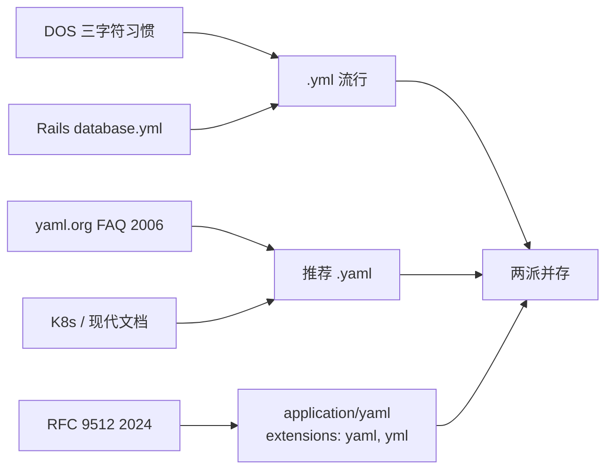

# .yml 与 .yaml：同一个东西，两套习惯

> 后缀之争没有功能含义，只有历史残留与社区习惯。官方推荐 `.yaml`；存量世界里 `.yml` 仍到处都是。

## 结论先行

- **解析器不区分后缀**：无论叫 `.yml` 还是 `.yaml`，内容都是 YAML 文本流。
- **官方偏好 `.yaml`**：yaml.org / YAML Company 的 FAQ 长期写着 *Please use `.yaml` when possible*；2006 年 Wayback 存档的 FAQ 已有同样措辞。
- **`.yml` 的来历**：DOS/Windows 时代扩展名常被压成三字符（对比 `.htm` / `.html`），加上 Rails 祖传的 `database.yml`，把习惯钉死了。
- **2024 年 MIME 收口**：RFC 9512 注册 `application/yaml`，文件扩展名写明 **`yaml`（preferred）和 `yml`**——官方句号有了，手指记忆不会一夜改掉。

## 社区分布（观察，非普查）

| 阵营 | 常见后缀 | 说明 |
| --- | --- | --- |
| Kubernetes / 多数云原生示例 | `.yaml` | 官方文档、kubectl 示例偏四字符 |
| 老牌 Ruby / 部分 CI | `.yml` | Rails、部分 GitHub Actions 示例仍见 `.yml` |
| GitHub 仓库搜索 | 两者都大量存在 | 工具链通常两者都接受 |

## 实践建议

1. **新项目统一 `.yaml`**，与 FAQ / MIME 一致。
2. **不要为了改后缀批量 rename 祖传文件**——收益为零，diff 噪音极大。
3. CI / editorconfig 里把两种都纳入 YAML 规则即可。

## 为什么争论会一直存在

后缀争论本质不是技术争论。解析器读的是字节流，扩展名只影响操作系统关联、编辑器语法高亮默认表、以及人类在文件树里的肌肉记忆。Rails 把 `database.yml` 写进教程之后，整代人的"配置文件就该叫 yml"被钉死；Kubernetes 文档又把 `.yaml` 推成另一种默认。两边都有大量正确仓库，工具链只好两者都认。

RFC 9512 把这件事写进 IANA 注册表时，选择了务实措辞：preferred 是 `yaml`，同时承认 `yml`。这等于官方说"请尽量用四字符"，又承认三字符不会消失。对仓库维护者，最优策略从来不是宗教战争，而是**新文件跟官方走，旧文件别为改名制造无意义 diff**。

## 和 MIME 的关系

在 HTTP / 邮件 / 对象存储元数据里，比后缀更重要的是媒体类型。历史里流传过 `text/yaml`、`application/x-yaml` 等未注册用法；RFC 9512 把它们标成 deprecated alias，统一到 `application/yaml`，并提供 `+yaml` 结构化后缀（例如未来某 `application/vnd.foo+yaml`）。配置文件落盘时后缀习惯仍分裂，但**网络交换层终于有了单一正确答案**。

## 来源

- [一手] YAML FAQ（YAML Company）：https://yaml.com/resources/faq/
- [一手] Wayback 2006-09 FAQ：https://web.archive.org/web/20060924190202/https:/yaml.org/faq.html
- [一手] RFC 9512 *YAML Media Type*（2024-02）：https://www.rfc-editor.org/rfc/rfc9512.html
- [二手] Stack Overflow 讨论（社区习惯）：https://stackoverflow.com/questions/22268952/what-is-the-difference-between-yaml-and-yml-extension
