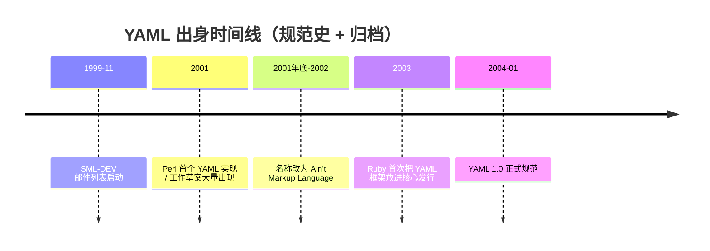

# 出身：2001，反 XML 邮件列表里的一封帖子

> YAML 不是从零发明的"下一代标记语言"，而是从 **SML-DEV（简化 XML）** 讨论里长出来的数据序列化格式。

## 人物与现场

| 角色 | 贡献（据规范史） |
| --- | --- |
| Clark Evans | 早期推动；与 Oren 在 SML-DEV 讨论简化 XML |
| Oren Ben-Kiki | 把想法收成更干净的格式 |
| Ingy döt Net（Brian Ingerson） | 带着 Perl `Data::Denter` 的序列化经验加入 |

规范 1.2.2 的 *YAML History* 写得很清楚：项目根扎在 Clark/Oren 的 **SML-DEV** 列表，以及 Ingy 的纯文本序列化模块；三人经 **yaml-core** 邮件列表协作约三年后，于 2004 年初发布 YAML 1.0。

Ingy 维护的 [sml-dev-archive](https://github.com/yaml/sml-dev-archive) 说明：SML-DEV 始于 1999 年 11 月，是对当时 XML 复杂化不满的一群人；YAML 的构思就在这批邮件里成型。

## 名字的两次人生

1. **Yet Another Markup Language**——早期工作草案标题仍是这个（例如 2001-05-26、2001-08-01 历史草案），自嘲"又一个标记语言"。
2. **YAML Ain't Markup Language**——递归缩写，强调处理的是**数据**而非文档标记。2002-04-07 附近的历史草案标题已切到 *Yaml Ain't Markup Language*。

发音：规范写 *rhymes with "camel"*（念成「雅梅」一类，不是「Y-A-M-L」逐字母）。

## 它要解决什么

2001 年前后 XML 配置的痛点：标签噪音淹没数据、信息型号语言原生结构不对齐（XML 是带属性的树；YAML 要的是 list / map / scalar）。早期草案 *Relation to XML* 一节明确说：XML 继承 SGML、面向结构化文档；YAML 更贴近现代语言原生数据结构与消息传递。

## 一手 vs 二手

- **一手**：yaml.org 规范史、历史工作草案 HTML、sml-dev-archive 说明。
- **二手**：各类百科/媒体复盘（域名注册日、某日 Draft 0.1 帖子等细节）——本仓库原 README 引用过部分二手时间点；本文以规范史为准，不编造未核到的精确发帖时刻。

## SML-DEV 在吵什么

1999–2001 前后，XML 正从文档标记走向"万物皆可 XML"。一部分人觉得 SGML 遗产带来的复杂性（DTDs、命名空间争论、空白规则等）压过了收益，于是拉出简化路线——SML-DEV 邮件列表就是那条分叉。Clark Evans 在讨论里逐渐意识到：与其继续削 XML，不如直接面向语言原生的 list/map/scalar 做一种**给人读的序列化**。Ingy 的 `Data::Denter` 证明纯文本缩进序列化在 Perl 里已经能用；Oren 则把草案收成更可实现的形态。

这解释了 YAML 为什么一边像"配置文件"，一边又死活要当"完整数据语言"：它的基因同时来自**反 XML 的可读性诉求**和**动态语言序列化诉求**。两条基因后来打架的地方，正是隐式类型。

## 和 XML 信息模型的刻意决裂

早期草案写得很直白：XML 主结构是带属性的树；YAML 主结构在序列与映射之间切换，外加标量。对 Python/Perl/Ruby 程序员，后者几乎零映射成本；前者往往要 DOM 或约定层。YAML 赌的是：配置与消息传递场景里，**原生数据结构对齐**比 SGML 兼容更重要。二十年后云原生的胜利，很大程度上是这场赌注踩中了 API 对象模型。

## 来源

- [一手] YAML 1.2.2 §1.2 History：https://yaml.org/spec/1.2.2/#12-yaml-history
- [一手] 历史草案 2001-05-26：https://yaml.org/spec/history/2001-05-26.html
- [一手] 历史草案 2002-04-07：https://yaml.org/spec/history/2002-04-07.html
- [一手] sml-dev-archive：https://github.com/yaml/sml-dev-archive
