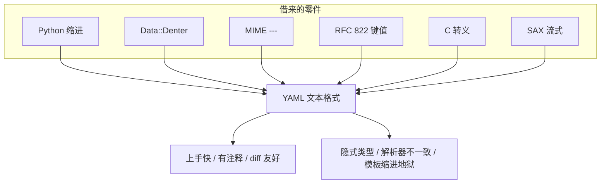

# 设计血统：全是借来的好零件

> YAML 的性格很好解释：每个零件都眼熟，拼起来的类型语义却没人能一眼看全。

## 零件表

| 零件 | 借自 | 留下的性格 |
| --- | --- | --- |
| 缩进表示层级 | Python | 对人友好；对模板引擎不友好 |
| 纯文本序列化思路 | Perl `Data::Denter`（Ingy） | "写给人看的数据结构" |
| `---` 文档分隔 | MIME（RFC 2046） | 一流多文档；K8s manifest 吃这一套 |
| `key: value` | RFC 822 邮件头 | 配置文件一眼能读 |
| 转义序列 | C | 双引号标量里的 `\` |
| 流式处理 | SAX 启发 | 单遍处理目标（规范 Goals） |

规范 Goals（优先级递减）里，第一条就是 *easily readable by humans*；第三条是 *match the native data structures of dynamic languages*——血统表和目标是对齐的。

## 为什么"拼装"会埋雷

每个来源都解决过自己的问题，但**没有一个来源负责"无引号标量的类型解析规则"**——那是 YAML 自己叠上去的 schema 层（1.1 的 bool/int/float/timestamp 推荐正则尤其宽）。于是：

- 语法层看起来像"加强版配置文件"；
- 语义层却是"带隐式类型的序列化语言"。

配置场景要的是确定性；序列化场景要的是表达力。YAML 两条都想要，坑就从这里长出来（见 `07`、`08`）。

## 规范 Goals 如何回响血统

1.2.2 把目标按优先级排列：人可读第一，跨语言可移植第二，匹配动态语言原生结构第三……实现容易排在后面。血统表里的零件几乎都在服务前三条；**实现容易**却长期没满足——规范体量巨大、隐式类型跨版本漂移、解析器符合性参差，都是代价。

MIME 的 `---` 让一流多文档成为一等公民，这直接喂养了 `kubectl apply -f` 多资源文件习惯；Python 缩进让人爱不释手，却让 Helm 在模板外侧对齐空白变成一门手艺。血统不是装饰，是性格说明书。

## "眼熟"的双刃剑

借 RFC 822 的 `key: value`，新人五分钟能写配置；借 C 转义，双引号字符串能力完整。但眼熟会带来错误类比：有人以为 YAML 就是"能写注释的 JSON"，直到 `NO` 变成 `false`；有人以为缩进和 Python 完全一样，直到 Tab 与空格混用；有人以为 `<<` 合并键是 1.2 核心，直到换解析器消失。拼装语言的学习曲线前端平缓、后端陡峭——资深用户的价值，往往是走过陡峭段之后的坑位地图。

## 来源

- [一手] YAML 1.2.2 Goals & History：https://yaml.org/spec/1.2.2/
- [一手] 早期草案 Relation to XML：https://yaml.org/spec/history/2001-08-01.html
- [一手] RFC 2046（MIME）：https://www.rfc-editor.org/rfc/rfc2046
