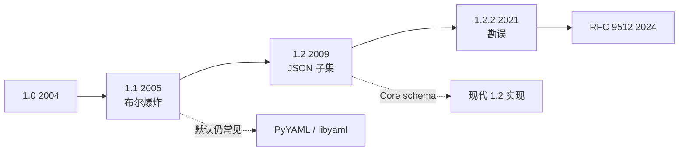

# 规范版本线：1.1 埋雷，1.2 收编 JSON，MIME 收口

> 版本号写在纸上是一回事；解析器默认按哪套 schema 跑，是另一回事。

## 版本表

| 版本 | 日期 | 关键变化 |
| --- | --- | --- |
| 1.0 | 2004-01-29 | 首个正式规范 |
| 1.1 | 2005-01-18 | 功能膨胀；隐式类型推荐（含宽布尔）在此成型 |
| 1.2 | 2009-07-21 | 主目标：JSON 成为 YAML 的严格子集；砍掉许多问题隐式类型推荐 |
| 1.2.2 | 2021-10-01 | 现行修订：勘误与澄清，**无规范性行为变更** |
| MIME | 2024-02 | RFC 9512 注册 `application/yaml` 与 `+yaml` |

## 1.1 → 1.2：到底改了什么（对配置作者最要紧的）

1.2 历史章节写明：主焦点是让 YAML 成为 JSON 的严格超集，并 *removed many of the problematic implicit typing recommendations*。
实践上最常被提到的：

- 布尔：1.1 的 `yes/no/on/off/y/n` 等（见 [yaml.org/type/bool.html](https://yaml.org/type/bool.html)）不再是 Core schema 的隐式布尔；
- 与 JSON 对齐的数字/空值规则更干净；
- 非 ASCII 换行符处理为兼容 JSON 做了调整（规范正文有说明）。

## MIME：`application/yaml`

RFC 9512（Informational，2024-02）向 IANA 注册：

- 媒体类型：`application/yaml`
- 结构化后缀：`+yaml`
- 扩展名：`yaml`（preferred）、`yml`
- 废弃未注册别名：`application/x-yaml`、`text/yaml`、`text/x-yaml`

安全章节提醒：YAML 可携带别名图、可扩展标签——**反序列化不可信输入有风险**（见 `15`）。

## 长尾事实

规范 2009 年就进 1.2，但 **PyYAML 官方仍标 YAML 1.1**；libyaml 同系。于是"规范说 A、解析器做 B"成了生态常态——详见 `10`。

## 为什么 1.2.2 仍值得单独记一笔

1.2.2 自称无规范性行为变更，却做了两件工程上重要的事：把规范源切换到更开放的 Markdown 流程，以及明确"规范看起来复杂，但 YAML 仍被当作完整序列化语言而非纯配置 DSL"。它还点明：自 1.2 发布十二年间人气暴涨，待办清单很长。KYAML、StrictYAML、各类 1.2 新实现，都可以看作生态在规范演进缓慢时的**旁路纠偏**。

## 应用作者该记住的版本策略

不要问"我们用的是 YAML 几"——要问"我们依赖的库默认 schema 是什么"。写 `%YAML 1.2` 指令并不能强迫 PyYAML 突然改用 Core schema。跨团队协作时，**引号纪律 + schema 校验**比争论版本号更能减少事故。MIME 类型则主要影响 HTTP API 与内容协商；本地仓库后缀策略仍按 `01` 处理即可。

## 来源

- [一手] Spec 1.2.2 History：https://yaml.org/spec/1.2.2/#12-yaml-history
- [一手] Spec 1.1：https://yaml.org/spec/1.1/
- [一手] bool type 1.1：https://yaml.org/type/bool.html
- [一手] RFC 9512：https://www.rfc-editor.org/rfc/rfc9512.html
