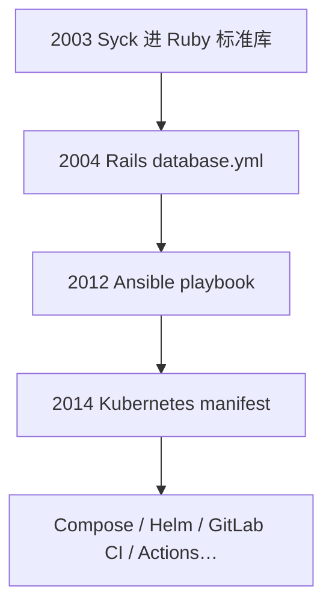

# 扩散链：Rails → Ansible → Kubernetes

> YAML 赢的是装机量竞赛。载体链比"设计最优"更能解释王座从哪来。

## 三级跳

1. **2003，Syck**：why the lucky stiff 的 C 解析器进入 **Ruby 标准库**——YAML 第一次有主流语言"户口"。规范史也写：Ruby 是第一个把 YAML 框架放进核心发行的语言。后来 Psych（libyaml）接棒。
2. **2004，Rails**：`config/database.yml` 成为无数教程第一课。一代 Web 程序员对"配置长什么样"的肌肉记忆，多半是这里塑的。
3. **2012，Ansible**：playbook 用 YAML；运维/DevOps 圈大规模入坑。
4. **2014，Kubernetes**：声明式 API 需要"写给人看的期望状态"。map/list/scalar 与 API 对象同构，`---` 支持多资源，注释可写运维备注——manifest 默认 YAML，加冕完成。
5. **生态引力**：Docker Compose、Helm、Kustomize、Argo CD、GitLab CI、OpenAPI 描述……**GitHub Actions 2018 初版用 HCL，2019 改版改投 YAML**——这是很有说服力的一票：存量习惯压过自研语法的诱惑。

## 为什么是"载体链"而不是"设计竞赛"

- 每个跳板都把 YAML 带进**更大的装机面**（Web → 运维 → 编排）。
- 后来者与其重新教育用户，不如顺应已会 YAML 的人。
- 对手格式（TOML/HCL/CUE…）往往在局部更优，但缺乏同等量级的"必经之路"产品。

## 为什么是这三级，而不是别的

YAML 早期在 Perl/Python 也有实现，但**Ruby 标准库 + Rails 教程**把"第一次接触配置文件"的场景锁定了。运维侧若只有 Puppet DSL / Chef Ruby，YAML 仍可能停留在小众；Ansible 选择 YAML playbook，等于把运维日常语言换成它。编排侧若 Mesos/Docker 生态走另一条配置哲学，K8s 也未必加冕成功——但 K8s 选了声明式 API 对象，YAML 的 map/list 几乎是无痛映射。

GitHub Actions 的转向尤其耐人寻味：微软阵营并不缺 HCL/JSON 经验，却在 2019 年改版站到 YAML 一边。解读成"YAML 语法最优"过强；更稳的解释是**贡献者与示例市场已经被 YAML 教育完毕**，平台愿意买账。

## 装机量的正反馈

每多一个默认 YAML 的平台，教程、Stack Overflow 答案、生成器、linter 规则、面试题就多一层。后来者引入新格式的边际成本，不只是解析器，而是重新教育生态。这就是 QWERTY 效应在配置格式上的版本。

## 来源

- [一手] YAML 1.2.2 History（Ruby 2003、PyYAML/LibYAML 2006）：https://yaml.org/spec/1.2.2/#12-yaml-history
- [一手] Ruby Psych 文档：https://docs.ruby-lang.org/en/master/Psych.html
- [二手] GitHub Actions 从 HCL 迁 YAML 的社区复盘（时间点以官方 changelog/博客交叉核对为准）
- Ansible / Kubernetes 官方文档中的 YAML 示例（产品事实）
