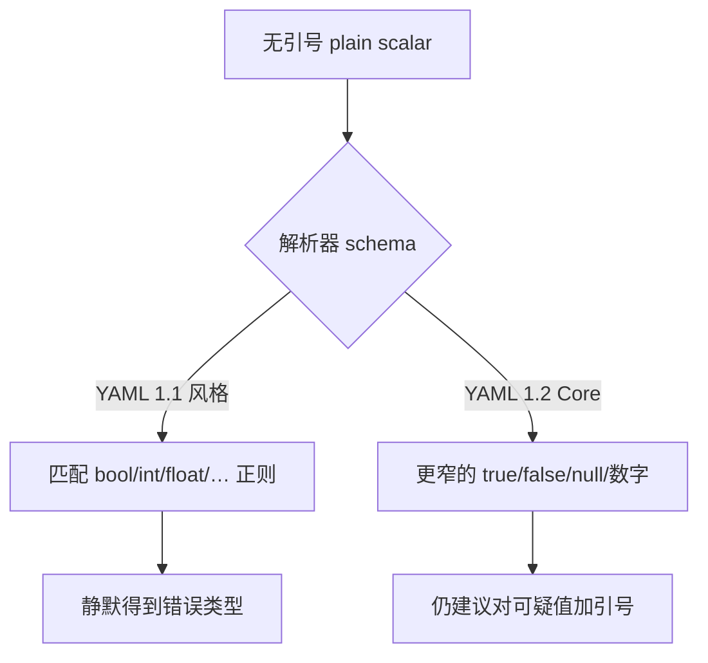

# 隐式类型推断：配置文件会静默地撒谎

> YAML 最大的设计债：它猜你写的值是什么类型，**猜错不报错**。

## 事故模式速查

| 写法 | 1.1 常见结果 | 你以为的 |
| --- | --- | --- |
| `country: NO` | `false` | 字符串 `"NO"` |
| `on: push` 的键 `on` | 布尔键 `true` | 字符串键 `"on"` |
| `version: 1.10` | float `1.1` | 字符串 / 精确小数 |
| `time: 22:30` | sexagesimal 整数 1350 | `"22:30"` |
| `mode: 0644` | 八进制 420（1.1） | 字符串权限 / 十进制 |

共同点：**文件合法、无报错、行为悄悄错**——比语法错误贵一个数量级。

## 根因分层

1. **Plain scalar**（无引号）触发 tag resolution。
2. **Schema** 决定正则有多宽（1.1 bool 页的正则极宽）。
3. **应用** 若把结果当字符串用，类型已经错了却可能很晚才爆。

## 纪律（最低成本缰绳）

- 国家码、开关词、版本号、时间、权限位、以 `0` 开头的串：**一律加引号**。
- 关键式标签 `!!str` 可强制，但可读性不如引号。
- CI 里用 schema（OpenAPI / JSON Schema / CRD）把"期望类型"钉死。

深挖挪威问题见 `08`；`on:` 见 `09`；解析器默认见 `10`。

## 为什么"静默错误"特别贵

语法错误会在 CI 红灯；类型猜错却可能：
- 在测试环境碰巧没覆盖挪威/开关词路径；
- 被另一个 1.2 解析器读成字符串，在 1.1 解析器读成布尔，造成"我这边正常"的互责；
- 写入 etcd/API 后以错误 JSON 类型持久化，修复要做数据迁移。

所以缓解不能只靠"小心点"，而要靠**可自动执行的纪律**：引号约定、schema、禁止 unsafe load、对渲染结果再校验。

## 和 JSON 子集叙事的张力

1.2 宣传合法 JSON 即合法 YAML，容易让人以为"按 JSON 心态写 YAML 就安全"。其实 plain scalar 路径仍可能走 YAML 的 tag resolution；只有坚持 JSON 风格的引号与类型写法，或改用 KYAML 这类强制引号值的子集，才能逼近那种安全感。

## 来源

- [一手] YAML 1.1 bool：https://yaml.org/type/bool.html
- [一手] YAML 1.2.2 Core / JSON schema 章节：https://yaml.org/spec/1.2.2/
- [二手] 各类 "Norway problem" 复盘（见 `08` 文献）
