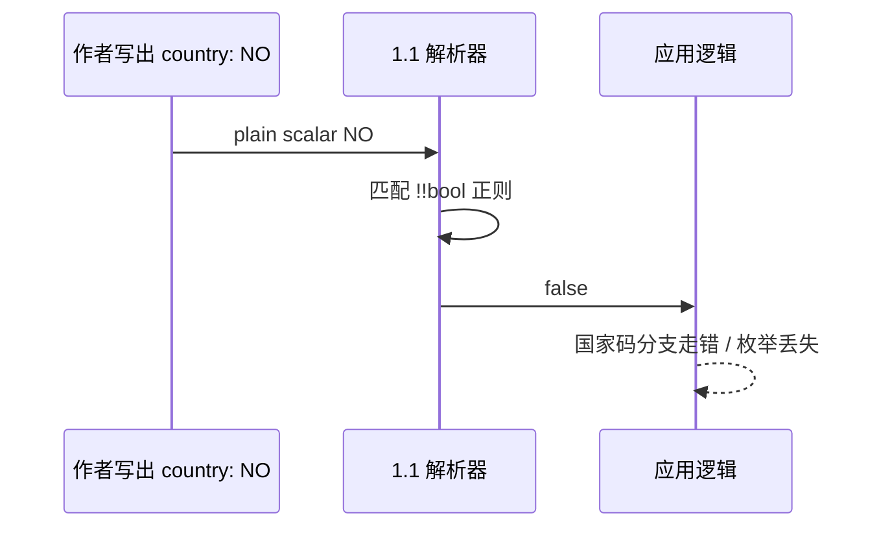

# 挪威问题（The Norway Problem）深挖

> 任何人用 YAML 够久，迟早会在缩写挪威时被烫到一次。

## 现象

```yaml
NI: Nicaragua
NL: Netherlands
NO: Norway   # 在 YAML 1.1 隐式布尔下，键或值都可能变成 false
```

YAML 1.1 布尔类型规范给出的正则包括：

```
y|Y|yes|Yes|YES|n|N|no|No|NO
|true|True|TRUE|false|False|FALSE
|on|On|ON|off|Off|OFF
```

于是无引号的 `NO` / `No` / `no` 可被解析为布尔 `false`。国家代码、枚举、locale 列表里出现挪威，就变成经典事故。

## 规范层：1.2 修了，生态没修完

- **YAML 1.2** 收紧隐式类型推荐；Core schema 下布尔主要是 `true`/`false`（及大小写变体），不再把 `no` 当 false。
- **现实**：PyYAML、大量 libyaml 封装仍按 **1.1** 习惯工作。于是"规范已修、生产仍炸"长期并存。
- StrictYAML 等项目把 Norway 问题当作批判 YAML 隐式类型的核心论据；社区也指出应区分 1.1 意图行为与 1.2 已修复这一点。



## 修复手段

| 手段 | 例子 | 备注 |
| --- | --- | --- |
| 引号 | `country: "NO"` | 最通用 |
| 显式标签 | `!!str NO` | 有效但刺眼 |
| 换 1.2 解析器/schema | ruamel.yaml、eemeli/yaml 等 | 要确认默认 schema |
| 禁止 plain 布尔词 | StrictYAML / KYAML 策略 | 子集方案 |

## 证据分级

- **一手**：yaml.org 1.1 bool 页；1.2.2 schema 章节。
- **一手/工程**：OpenAPI Generator、Nacos、Spring 等 issue 中复现 `NO`→`false`（说明问题仍在工具链中活着）。
- **二手**：博客命名 "YAML-Norway Law"——说法流行，但具体公司事故传闻需各自核原始 postmortem；**本文不把未核到的公司名当一手事实**。


## 为什么叫"挪威"而不是"布尔词问题"

因为 `NO` 是真实世界高频出现的 ISO 国家码，落在 1.1 布尔正则正中心。`DE`/`FR`/`US` 不会中招，`NO` 会——于是 demos、locale 枚举、地址表单、CDN 国家列表成了复现温床。工程 issue 里反复出现的模式是：作者用 YAML 写 enum，生成器或框架再 dump 一次，`NO` 变成 `false` 再被写成 `"false"` 字符串，语义彻底漂移。

## 教育成本

每次向新人解释 Norway，都在支付隐式类型的税。1.2 纸面免税之后，PyYAML 默认仍征税，税负转嫁到培训文档与 linter 规则。KYAML 选择对值强制双引号，等于在 K8s 输出侧预缴这笔税，避免下一棒工具再猜。

## 来源

- [一手] https://yaml.org/type/bool.html
- [一手] https://yaml.org/spec/1.2.2/#10212-boolean
- [工程] openapi-generator#18510：https://github.com/OpenAPITools/openapi-generator/issues/18510
- [工程] nacos#12969：https://github.com/alibaba/nacos/issues/12969
- [二手] https://allan.reyes.sh/posts/yaml-norway-law/
- [讨论] strictyaml#186（纠正"1.2 仍有 Norway"的表述）：https://github.com/crdoconnor/strictyaml/issues/186
