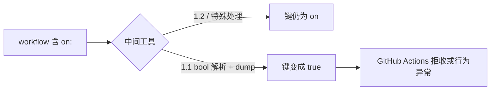

# GitHub Actions 的 `on:` 键：工具链互操作经典坑

> 工作流语法里的触发键叫 `on`。问题通常不在 GitHub 自己怎么解析，而在**你管道里其他 YAML 1.1 工具**怎么改写它。

## 发生了什么

YAML 1.1 把 `on`/`On`/`ON` 视为布尔 `true`。于是某些 dump/load 循环会把：

```yaml
on:
  push:
    branches: [main]
```

变成类似：

```yaml
true:
  push:
    branches: [main]
```

键名丢了，Actions 语法直接废掉。ytt 等工具的 issue 标题就直呼 `"on:" as keyword becomes "true:"`。



## GitHub 侧

GitHub Actions 工作流文档按 YAML 描述语法；生态上普遍按 **字符串键 `on`** 书写。官方文档示例使用未加引号的 `on:`——在其自身解析路径下可用。

踩坑高发区：

- 用 PyYAML `safe_load` + `dump` 做"格式化/合并"；
- 某些策略引擎、ytt、代码生成器；
- 自动加引号的 lock 文件生成器（反而会出现 `"on":`）。

## 缓解

1. 中间处理使用 **1.2 Core** 或关闭布尔词隐式转换的库。
2. 若必须过 1.1 解析器：写成 `"on":`（Actions 接受引号键）。
3. 对工作流做 schema/actionlint 校验，禁止键类型漂移。


## 互操作测试建议

若你的平台会读取、合并、再写出 Actions workflow：

1. 准备最小 fixture：含 `on:` / `off` 相关键与挪威码值。
2. 过一遍你们的 YAML 库 dump/load。
3. 用 actionlint 或 schema 断言键名仍是字符串 `on`。
4. 若必须支持 1.1 库，输出端统一给敏感键加引号。

这比在生产里发现"触发器没了"便宜几个数量级。问题不在 GitHub 文档写了 `on:`，而在**中间人解析器的 schema 年代错配**。


## 为什么这比 Norway 更"工程化"

Norway 多半伤害业务数据；`on:` 伤害的是**流水线能否启动**。工作流文件常被平台、安全扫描、自动合并 bot、代码生成器来回读写。只要链路里有一环用 YAML 1.1 布尔规则做 load+dump，键名就可能被改写。作者在 GitHub UI 里看到的示例永远是正确的 `on:`，于是排障时会怀疑自己复制错了，而不是怀疑中间工具。

把敏感键写成 `"on":` 是丑陋但有效的防御；更干净的做法是中间件升级到 1.2 Core，或对 Actions 文件走专用 parser（理解工作流 schema，而不是通用 YAML dump）。


## 来源

- [一手] Workflow syntax：https://docs.github.com/en/actions/using-workflows/workflow-syntax-for-github-actions
- [一手] YAML 1.1 bool（含 on）：https://yaml.org/type/bool.html
- [工程] carvel-ytt#275：https://github.com/vmware-tanzu/carvel-ytt/issues/275
- [工程] gh-aw 讨论引号 `on`：https://github.com/github/gh-aw/issues/32354
