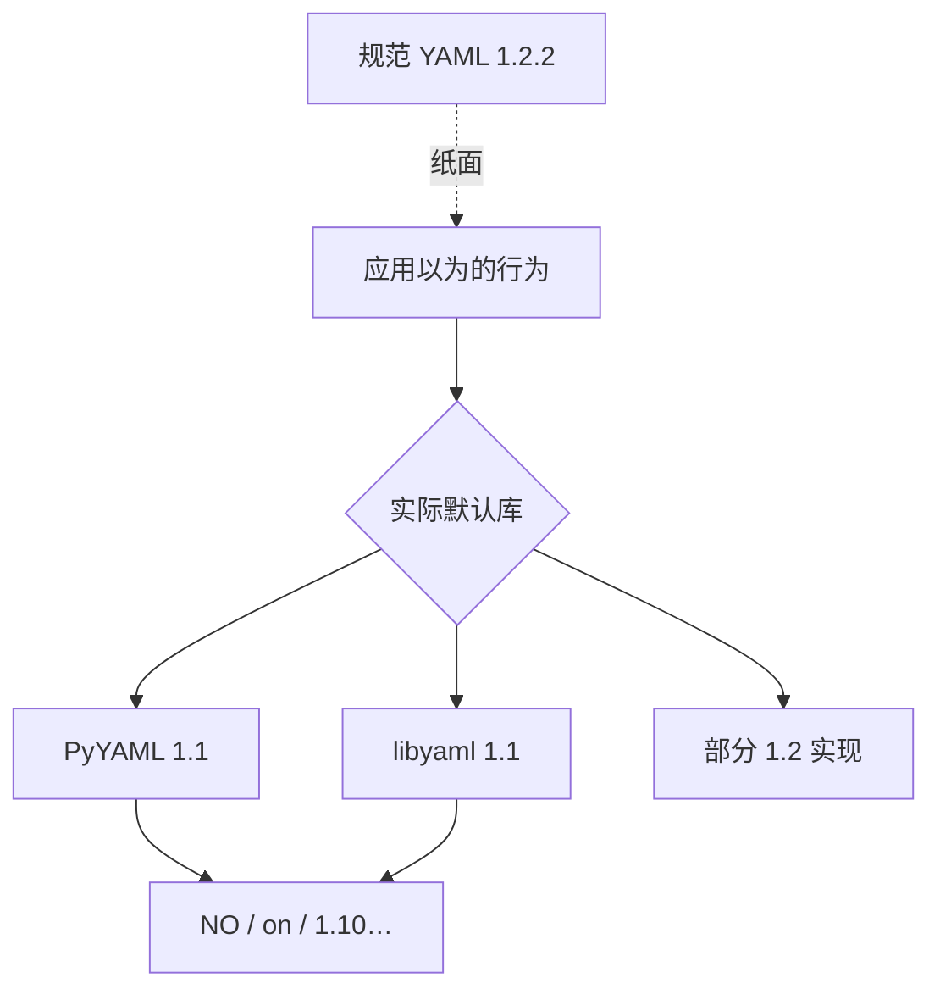

# 解析器矩阵：规范 1.2 了，默认却常常还是 1.1

> 选库时问三句：默认 schema 是哪版？safe load 默认开吗？还在维护吗？

## 速览矩阵

| 库 | 语言 | 常见默认 | 备注 |
| --- | --- | --- | --- |
| **PyYAML** | Python | **YAML 1.1** | Ansible 等基石；`safe_load` 防任意对象，**不**等于 1.2 |
| **libyaml** | C | 1.1 系 | 大量绑定的底座 |
| **ruamel.yaml** | Python | 可走 1.2 | 强调 round-trip / 注释保留 |
| **Psych** | Ruby | libyaml 封装，官方叙述偏 1.1 | Ruby 标准库；另有实验性 libfyaml 后端讨论 |
| **go-yaml / gopkg.in/yaml.v3** | Go | 行为复杂；布尔词有特殊规则 | K8s 生态深度依赖；上游演进见 yaml.org 组织 fork |
| **goccy/go-yaml** | Go | 标 1.2 | 纯 Go 实现之一 |
| **serde_yaml** | Rust | 曾广泛使用 | **原 crate 已宣布弃维**；迁移看 yaml 组织 fork / 替代 |
| **eemeli/yaml** | JS | 默认 1.2 Core | 可切换 1.1 schema |

## PyYAML 安全 API 与版本别混

- `safe_load`：只解析基本 YAML 标签，**避免** `!!python/object` 一类反序列化 RCE；
- 它**不会**魔法升级到 1.2 布尔规则。
- 自某版本起 `yaml.load` 必须显式传 `Loader=`，降低误用面。

## 实践建议

1. 新 Python 服务若要 1.2 语义，评估 `ruamel.yaml` 或明确 schema 的库，而不是假设升级 PyYAML 即可。
2. 跨语言交换配置：对可疑标量**一律引号**，比统一解析器版本便宜。
3. K8s 工具链：关注 sigs.k8s.io/yaml 与 go-yaml fork 的行为说明；KYAML 输出绕开一部分 plain 标量陷阱（见 `18`）。

## 选库决策树（实用）

1. 只要安全加载配置、接受 1.1 布尔坑 → PyYAML `safe_load` + 引号纪律。
2. 需要注释 round-trip / 倾向 1.2 → 看 `ruamel.yaml`。
3. Go / K8s 工具 → 跟社区主流（sigs.k8s.io/yaml 系），并理解 KYAML 输出动机。
4. Rust → 确认 crate 维护状态；勿盲信已弃维包名。
5. 跨语言交换 → 契约层用 JSON Schema；文本层对歧义标量强制引号。

"我们符合 YAML 1.2"若无法指出具体 schema 与测试集，只是营销句。以 Norway / `on` / `1.10` / `0644` 四件套做冒烟，比背版本号有用。

## 来源

- [一手] https://yaml.org/libraries/
- [一手] PyYAML 文档：https://pyyaml.org/wiki/PyYAMLDocumentation
- [一手] Psych：https://docs.ruby-lang.org/en/master/Psych.html
- [工程] dtolnay/serde-yaml 弃维说明（release notes）
- [二手] Psych/libfyaml 符合性讨论：https://durableprogramming.com/blog/how-compliant-is-psych/
