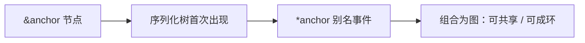

# Anchors、Aliases 与合并键

> `&` 打桩，`*` 引用——强大，也是 YAML bomb 与"读入再写出就丢引用"的根源。

## 语法直觉

第一次出现的节点用 `&name` 锚定，之后用 `*name` 引用同一节点。规范模型里这是图，不是树：一个节点可以有多个入边，甚至成环（实现若随意展开会爆炸）。

```yaml
bill-to: &id001
  given: Chris
  family: Dumars
ship-to: *id001
```



## 合并键 `<<`

1.1 生态流行 `<<: *defaults` 把映射合并进当前映射。许多解析器仍实现 `tag:yaml.org,2002:merge`，但 1.2 不再把它当核心推荐。换库时合并键可能失效，属于隐性依赖。

Helm 文档给了更尖锐的工程警告：anchors 在 decode→encode 后经常被**展开并丢弃**。K8s/Helm 天天 read-modify-write，锚点不是可靠的复用单元；跨 chart 复用应走 **library chart** 或生成器。

## 何时还能用

- 单文件内、短生命周期、不经过格式化工具的局部复用；
- 测试夹具里表达共享结构。

## 风险清单

1. **别名炸弹**：递归别名指数膨胀（见 `15`）。
2. **审查困难**：`*ref` 跳转成本高，PR 易漏看。
3. **工具链丢失**：yamllint/格式化/转换后锚点消失，diff 巨响。
4. **合并键不可移植**：当作 1.1 扩展，而非万能语法。


## 和编程语言引用的类比（及不同）

别名看起来像指针，但生命周期绑在**文档解析过程**。一旦序列化树被做成语言对象再 dump，多数库不会尝试恢复锚点，而是写出展开后的树。于是"DRY 的 YAML"经过一次工具处理变成"重复的 YAML"。若团队把锚点当模块系统，很快会在格式化 PR 里看到无意义的大面积 diff，或更糟：有人手工改了一处副本、忘了另一处。

合并键则更像"编译期 mixin"。它在 1.1 工具链里好用，却不是所有 1.2 实现的一等公民。依赖它等于依赖特定解析器方言——与 KYAML"子集求可预测"的方向相反。


## 来源

- [一手] Spec anchors/aliases：https://yaml.org/spec/1.2.2/
- [一手] Helm YAML Techniques：https://helm.sh/docs/chart_template_guide/yaml_techniques/
