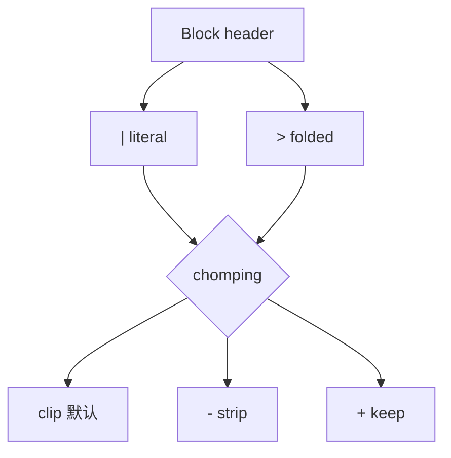

# 标量与多行：`|` / `>` 与 chomping

> 配置里一半的缩进灾难，来自"多行字符串到底有没有保留换行"。

## 风格选择

| 风格 | 标记 | 换行语义 | 典型用途 |
| --- | --- | --- | --- |
| Plain | 无引号 | 可折行；易触发隐式类型 | 简单词 |
| Double-quoted | `"..."` | `\n` 等转义 | 需转义或防类型猜解 |
| Single-quoted | `'...'` | 几乎字面；`''`→`'` | 含大量反斜杠 |
| Literal | `\|` | **保留**换行 | 证书、脚本、kubeconfig 片段 |
| Folded | `>` | 单换行常折空格 | 长段落散文 |

## Chomping

Block header 可加 `-`（strip）或 `+`（keep）：

- 默认 clip：留最后一次换行，剥掉更后面的空行；
- strip：去掉结尾换行，适合"单行命令"类值；
- keep：保留末尾空行，少见但有时用于格式敏感载荷。



## 与模板协作

Helm 官方模式：

```yaml
myfile: |
  {{- .Files.Get "myfile.txt" | nindent 2 }}
```

先用 `{{-` 吃掉左侧空白，再用 `nindent` 统一垫缩进，避免"第一行悬空"导致 `did not find expected key`。把多行规则想成**空间敏感的文本协议**，而不是随便换行的 Markdown。


## 字面量块的缩进规则容易踩的点

`|` 后面第一行内容的缩进决定了块的基线。若第一行比后续行少缩进，解析器会报结构错误；若模板引擎多吐一个空行，基线可能被空行干扰。Helm 文档甚至建议有时放一行注释当"假第一行"来稳住缩进——代价是注释会进入字符串内容，只适合消费者能忽略该行的场景。

Folded `>` 适合散文，不适合需要精确换行的私钥或脚本；脚本、证书、dotenv 片段优先 `|`。需要去掉结尾换行时用 `|-`，避免把额外 `
` 喂进对空白敏感的下游。


## 来源

- [一手] Spec §8.1：https://yaml.org/spec/1.2.2/
- [一手] Helm YAML Techniques：https://helm.sh/docs/chart_template_guide/yaml_techniques/
