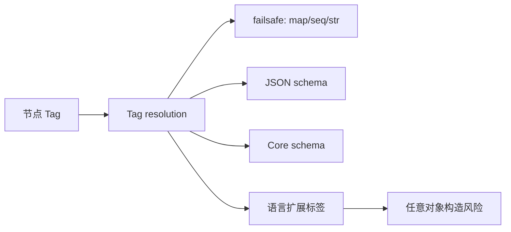

# Tags 与自定义类型

> `!!str`、`!!binary`、`!本地标签`——类型系统的显式出口；也是反序列化攻击面。

## 二级标签句柄

| 写法 | 含义 |
| --- | --- |
| `!!str` / `!!int` … | 默认二次句柄 → `tag:yaml.org,2002:*` |
| `!local` | 应用本地标签 |
| `!<tag:example.com,2000:app/foo>` | 逐字全局标签 |
| `%TAG !e! tag:example.com,2000:app/` | 指令声明句柄前缀 |

强制字符串避免 Norway：

```yaml
country: !!str NO
```

## 语言绑定里的"自定义类型"

- PyYAML：`!!python/object`、`!!python/object/apply` 等——**UnsafeLoader 可执行构造**。
- SnakeYAML：可构造任意 Java 类——历史 CVE 密集。
- 应用本地 `!MyType`：只有注册了构造器才安全可知。



## 建议

- 配置场景：优先引号 / schema，少用自定义 tag。
- 反序列化不可信输入：只允许 failsafe/core，禁用语言对象标签（见 `15`）。


## Tags：显式类型的正当用法与歪用法

正当用法是消除歧义：`!!str 2020-01-01` 防止被当成 timestamp；`!!int "80"` 在必须数字的字段里强制转换。歪用法是把 YAML 变成微型 RPC：`!!python/object/apply:os.system` 一类标签把文档变成代码。语言绑定若默认开启任意对象构造，配置文件就升级成攻击载荷。

团队规范可以写：业务配置只允许 failsafe/core 标签；任何自定义 `!Foo` 必须在代码审查里登记构造器与安全边界。需要丰富类型时，优先外置 JSON Schema，而不是发明更多 YAML 标签。


## 与 schema 的分工

Tag 解决的是"这个节点在 YAML 类型系统里是什么"；JSON Schema / CRD 解决的是"在业务模型里允许什么"。前者偏解析器，后者偏应用。生产系统应以后者为准做校验，前者只作消歧义的辅助。把业务枚举做成一堆 `!CountryCode` 自定义标签，通常会让跨语言客户端更痛苦。


## 来源

- [一手] Spec Tags / Schemas：https://yaml.org/spec/1.2.2/
- [一手] PyYAML 文档（Loader 种类）
