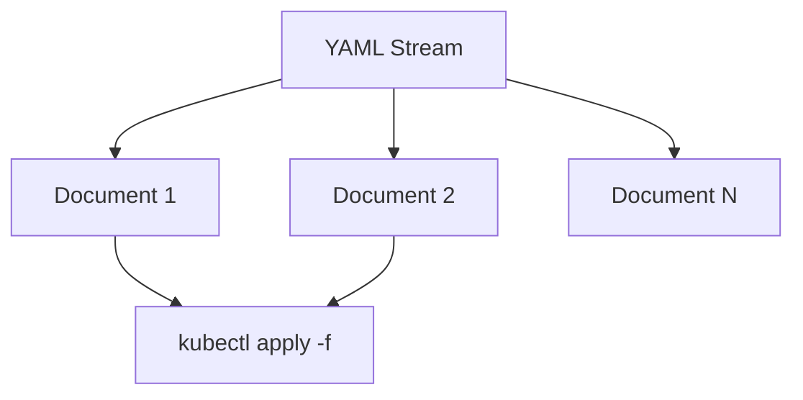

# 多文档流：`---` / `...`

> 一个文件里塞多份文档，是 YAML 相对 JSON 的超能力；也是工具"只读第一份"的坑来源。

## 语法

```yaml
# 文档 1
---
kind: Deployment
...
# 文档 2
---
kind: Service
```

- `---`：指令与内容的分界，也常当作文档开始标记。
- `...`：文档结束（通信流里有用）；许多配置文件省略。



## 生态中的用法

| 场景 | 行为 |
| --- | --- |
| `kubectl apply -f` | 接受多文档 |
| Helm template 输出 | 可多文档；渲染后再切分提交 |
| Helm `values.yaml` | **通常只用第一份文档** |
| 某些 CI 合并工具 | 只解析第一份 → 静默丢文档 |

## 建议

- 需要多资源：可以，但调试成本上升；Kustomize/Helm 结构往往更清晰。
- 写工具时：**明确** `load` vs `load_all`（PyYAML）、decoder 是否迭代多文档。


## 多文档是能力也是脚枪

`kubectl apply -f` 吃多文档很香：一个 PR 改一组相关资源。脚枪在于：大量通用 YAML 库默认 `load` 只返回第一份；测试绿了只因为断言打在第一份上，第二份 Service 从未部署。Helm values 更是明确偏向单文档。写工具时把 `load`/`load_all` 选择做成显式 API，并在文档写清；写清单时，若调试困难，拆文件往往比叠 `---` 更省时间。

通信流场景（长连接推送多个文档）会用 `...` 明确结束；磁盘上的 K8s/CI 文件多数省略 `...`，只保留 `---`。两者都合法，工具要容忍。


## 与 KYAML / JSON 的关系

KYAML 仍是 YAML，因此多文档流同样合法：每个文档可以是一个 flow-style 对象。JSON 本身没有多文档流标准（常见是 JSON Lines 另开协议）。若工具既要人读注释又要一流多资源，YAML/`---` 仍然更自然；若只要机器吞吐，考虑 JSONL。


## 来源

- [一手] Spec Chapter 9 Documents：https://yaml.org/spec/1.2.2/
- [一手] Helm YAML Techniques（多文档警告）：https://helm.sh/docs/chart_template_guide/yaml_techniques/
