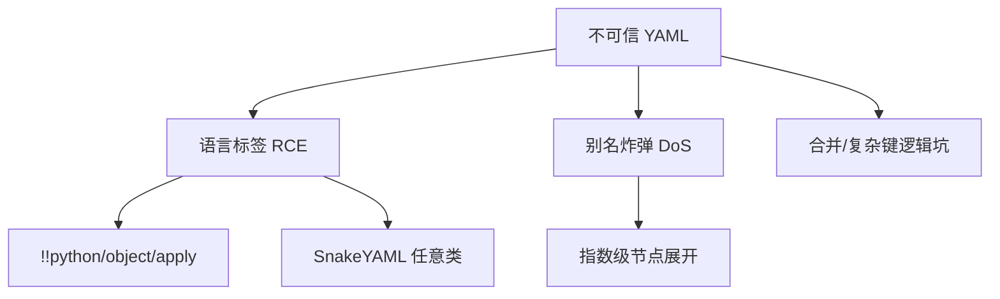

# 安全：反序列化、YAML bomb、不安全 Loader

> YAML 不只是"带注释的 JSON"。别名图 + 可扩展标签 = 资源耗尽与 RCE 面。

## 三类风险

### 1. 不安全反序列化（RCE）

- **PyYAML**：`unsafe_load` / 旧式默认 `load` 可构造 Python 对象。现代 API 要求显式 `Loader`；对不可信输入用 **`safe_load`**。
- **SnakeYAML**：历史多次出现 Constructor 相关 RCE；应用 `SafeConstructor` 或等效安全模式，并跟进版本。
- OWASP Deserialization Cheat Sheet 将 YAML 与 Java/Python 反序列化并列提醒。

### 2. YAML bomb（billion laughs 变体）

通过层层别名让解析器展开巨量节点，打满内存/CPU。缓解：限制别名深度/次数、限制输入大小、超时；SnakeYAML 等对非标量别名数量有过默认上限。

### 3. 内容层"注入"

未必是解析器 RCE：在 Helm 模板里把用户字符串裸插入，可造成 **YAML 结构注入**（多出键、改层级）——见 `19`。

## RFC 9512 的安全提醒

MIME 注册文档专设 Security Considerations：处理 YAML 时需考虑实体扩展、别名、以及与 JSON 子集关系下的互操作陷阱。

## 清单

1. 不可信输入 → safe/core schema only。
2. 禁止应用语言对象标签。
3. 限流：大小、别名、深度、时间。
4. 模板拼接当不可信数据处理。

## 配置场景 vs 序列化场景

把用户上传的 YAML 当对象图还原，等于开放反序列化入口；把仓库内受控的部署清单当数据读，风险模型完全不同。团队应显式分类：

- **受控配置**：仍建议 safe loader，防止供应链文件被塞进危险标签。
- **用户输入**：safe + 大小限制 + schema；最好先转 JSON 再校验。
- **模板渲染**：防的是结构注入，不是 `!!python`（见 Helm 章）。

YAML bomb 与 RCE 常被混谈：前者是可用性攻击，后者是代码执行；缓解控件重叠（限资源）但不相同（禁标签）。

## 来源

- [一手] RFC 9512 §4 Security：https://www.rfc-editor.org/rfc/rfc9512.html
- [一手] PyYAML load 弃用说明：https://github.com/yaml/pyyaml/wiki/PyYAML-yaml.load(input)-Deprecation
- [一手] OWASP Deserialization Cheat Sheet
- [工程] Google security-research SnakeYAML advisory
