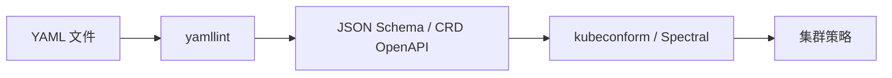

# Schema 与校验工具链

> YAML 本身几乎不替你校验业务形状。缰绳在 schema 与 linter 上。

## 分层

| 层 | 工具例 | 抓什么 | 抓不到什么 |
| --- | --- | --- | --- |
| 风格 | yamllint | 缩进、真假布尔风格、重复键 | 业务字段对错 |
| 结构 | JSON Schema | 类型、必填、枚举 | 集群里是否可调度 |
| K8s | kubeconform | 清单是否符合 OpenAPI | 运行时权限/配额 |
| API 描述 | Spectral | OpenAPI 质量规则 | 实现是否一致 |
| 策略 | OPA/Kyverno | 合规与准入 | 文件语法细节 |

## 为何必须外挂

隐式类型让"看起来像字符串"的值变成布尔；没有 schema，CI 只能靠人眼。KYAML 从输出侧减少歧义，schema 从输入侧钉死期望——二者一起，才接近"配置也能工程化"。

建议把校验当合并门槛：PR 必绿，而不是发布前手工点点。渲染型工具（Helm）应对**渲染结果**跑 kubeconform，而不仅对 values 跑 yamllint。

## 落地顺序建议

先上 yamllint 统一缩进与引用风格，立刻减少无意义争论；再对关键目录挂 JSON Schema（或 CRD OpenAPI）；最后把 Helm/Kustomize 的渲染产物送进 kubeconform。Spectral 留给 OpenAPI 仓库。策略引擎放最后，因为它回答的是"允不允许"，不是"写得对不对"。

若只能做一件事：对会进集群的 YAML 做 **schema + 渲染后校验**。只 lint 源 values、不看渲染结果，会漏掉模板拼接造成的结构错误。

## 来源

- yamllint / kubeconform / Spectral 官方文档
- Kubernetes OpenAPI / CRD 校验惯例
