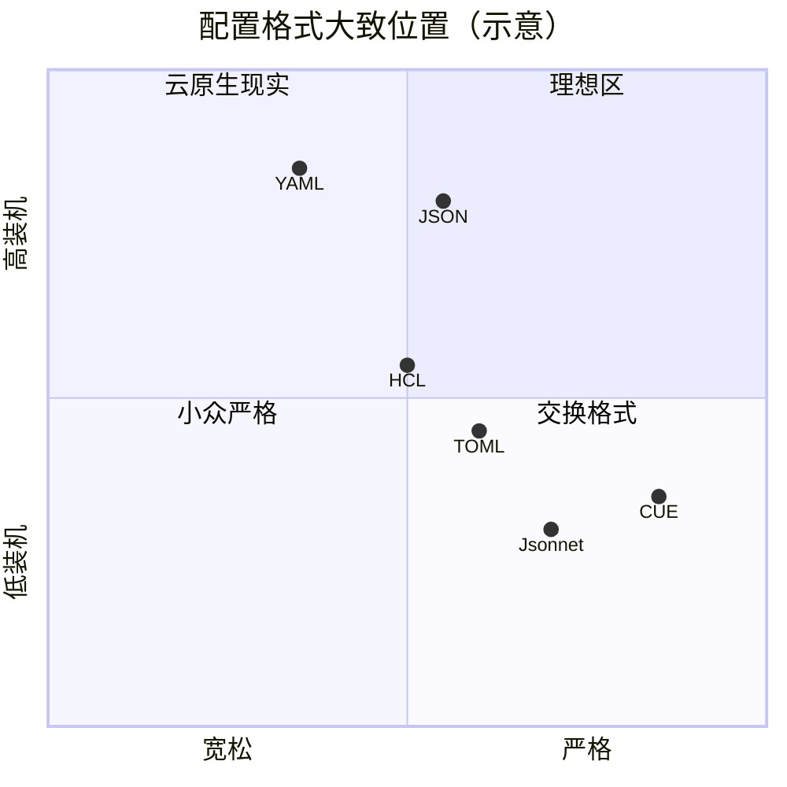

# 对照：JSON / TOML / HCL / CUE / Jsonnet

> 造反者很多。多数输给了装机量；少数在特定域赢了局部战争。

## 对比表（配置视角）

| 格式 | 注释 | 类型严格 | 深层嵌套 | 逻辑/类型系统 | 典型阵地 |
| --- | --- | --- | --- | --- | --- |
| **YAML** | 有 | 弱（隐式） | 强 | 无 | K8s、CI、Ansible |
| **JSON** | 无 | 相对干净 | 强但啰嗦 | 无 | API、许多工具交换 |
| **TOML** | 有 | 较明确 | 深嵌套弱 | 无 | Cargo、部分应用配置 |
| **HCL** | 有 | 中 | 中 | 有限表达式 | Terraform |
| **Jsonnet** | 有 | 中 | 强 | 生成式语言 | 部分 K8s 生成 |
| **CUE** | 有 | 强 | 强 | 约束/合并 | 配置校验与生成 |

## 为何没整体取代 YAML

- TOML 明确冲着"不要再 YAML 那套含糊"，但深树配置（K8s 对象）写起来别扭。
- HCL 在 Terraform 极强；GitHub Actions 仍从 HCL 迁去 YAML，说明**习惯面**可压过语法偏好。
- CUE/Jsonnet 解决"生成与约束"，学习成本与生态示例仍不如 YAML 广。
- JSON 永远在场，但缺注释 → 配置场景常被 YAML 当超集容器。

## 怎么跟领导解释"为什么还不换掉"

因为换格式的成本在生态不在语法。TOML 更清晰，却写不好深树 API 对象；HCL 在 Terraform 胜利，却没挡住 Actions 迁 YAML；CUE/Jsonnet 能生成与约束，却要团队学会一门小语言。JSON 永远适合机器交换，却难当手写配置的唯一真相。

务实组合往往是：人机界面继续 YAML（或 KYAML）；校验层用 CUE/JSON Schema；远程 API 用 JSON。不是单格式宗教，而是分层。

## 来源

- 各语言官方站点与规范（JSON RFC、TOML 规范、HCL、CUE、Jsonnet）
- Actions 迁 YAML 的产品事实（见 `05`）
