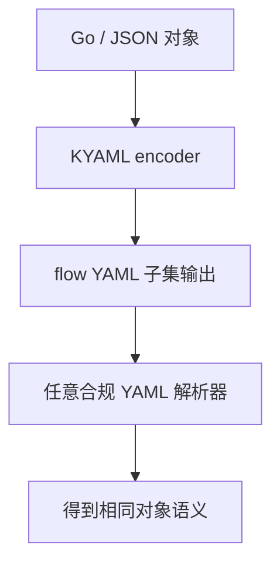

# Kubernetes KYAML（KEP-5295）

> K8s 官方选择给 YAML **套缰绳**，而不是换掉它。KYAML = 更安全、更少歧义的 YAML 子集（方言），仍是合法 YAML。

## 状态（以发布说明为准）

| 版本 | 状态 | 使用方式 |
| --- | --- | --- |
| **v1.34** | Alpha | `KUBECTL_KYAML=true` 后 `kubectl get -o kyaml` |
| **v1.35** | Beta，默认启用 | 直接 `-o kyaml`；可用 `KUBECTL_KYAML=false` 关掉 |

仅影响 **客户端输出**；apiserver 不另起编码。KYAML 输入对旧 kubectl 仍可当普通 YAML 吃。

## 设计要点（KEP / 文档）

1. **值字符串一律双引号** → 堵住 `NO`/`on` 等隐式类型。
2. **键默认不引**；不安全/歧义词才加引号。
3. **结构用 flow style**：`{}` / `[]` → **对空白不敏感**，Helm 类模板补丁更不容易因缩进出鬼。
4. 允许注释、允许尾逗号（相对 JSON 的人类友好点）。
5. 文档前放 `---`，避免被误认为残缺 JSON。



示例形态（示意）：

```yaml
---
{
  apiVersion: "v1",
  kind: "Pod",
  metadata: {
    name: "my-pod",
  },
}
```

## 它不是什么

- 不是新语言，不是服务器端新编码。
- 不强迫存量 block-style YAML 迁移。
- 不解决所有 YAML 复杂度；目标是**避开最常见陷阱**。


## 和"换掉 YAML"提案的关系

社区长期有人主张 K8s 改默认 JSON、或引入 CUE/Jsonnet。KEP-5295 的立场更克制：存量解析器与习惯不动，**输出方言**先把最疼的坑垫上。这与总论一致——王座来自装机量，官方选择套缰绳而不是退位。

对 Helm 作者，KYAML 的 flow style 降低空白敏感度，但与传统 block 模板混贴仍可能很难看；KEP 自己也警告 text-patch 混风风格会痛苦。迁移应是输出/示例双轨，而非一刀切。


## 使用建议（2026 视角）

- 交互排障：`kubectl get -o kyaml` 看强制引号后的真实字符串，有助发现类型问题。
- 文档双轨：新示例可附 KYAML，旧 block YAML 不必删。
- 自动化：在客户端版本矩阵未统一前，脚本勿假设 `-o kyaml` 处处可用；1.34 需环境变量，1.35 默认开。
- 不要把 KYAML 字节级输出当稳定 API；KEP 保留未来微调排版的权利，语义稳定优先于字节稳定。


## 来源

- [一手] KEP-5295：https://github.com/kubernetes/enhancements/blob/master/keps/sig-cli/5295-kyaml/README.md
- [一手] KYAML Reference（1.35 docs）：https://v1-35.docs.kubernetes.io/docs/reference/encodings/kyaml/
- [一手] Kubernetes 1.34 发布说明（Alpha KYAML）：https://kubernetes.io/blog/2025/08/27/kubernetes-v1-34-release/
- [一手] 1.35 SIG CLI highlights（Beta）：https://github.com/kubernetes/sig-release/discussions/2903
