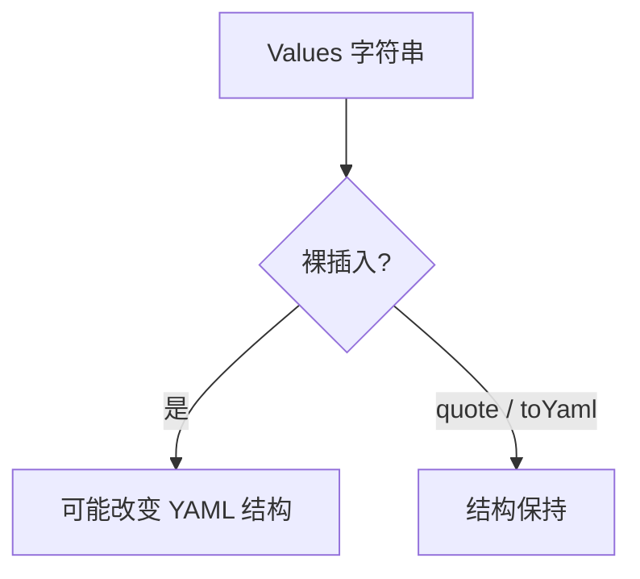

# Helm 模板 × YAML：缩进、toYaml、注入

> Helm 的痛，经常不是 Go template 语法，而是"**在 YAML 外边**把空白拼对"。

## 缩进与 `toYaml` / `nindent`

```yaml
resources:
  {{- toYaml .Values.resources | nindent 2 }}
```

`toYaml` 负责数据结构→YAML 文本；`nindent N` 负责换行并垫空格；`{{-` 吃掉左侧空白。`N` 必须大于父键缩进，否则字段漂到错误层级——仍然是合法 YAML，只是对象错了。这比模板报错更危险。

## YAML 注入

用户或环境传入的字符串若含换行、`: `、`- `，裸插 `{{ .Values.x }}` 能长出额外键。官方表：

| 目标 | 优先 | 避免 |
| --- | --- | --- |
| 字符串标量 | `quote` | 裸插 |
| 多行字符串 | `\|` + `nindent` | 无 block header 的 nindent |
| map/list | `toYaml \| nindent` | 手写拼接循环 |



## Anchors 与多文档

anchors 不适合当跨渲染复用方案（round-trip 丢失）。`values.yaml` 多文档常常只吃第一份。调试优先拆文件，而不是叠更多 `---`。


## 调试套路

1. `helm template` 把渲染结果落到文件，用编辑器看缩进，而不是只看 chart 源。
2. 对渲染结果跑 yamllint / kubeconform。
3. 若某 values 来自外部，单测里塞含换行与 `: ` 的恶意字符串，断言结构不被注入。
4. 需要复用片段时优先 `define`/`include` 或 library chart，而不是 YAML anchor。

把 Helm 当成"字符串拼 YAML"的引擎，安全性与正确性都靠约定与测试，不靠运气。


## 和 KYAML 的互动

KYAML 降低空白敏感度，理论上让模板补丁更轻松，但 KEP 也警告 flow 与 block 混贴会乱。短期现实仍是：chart 多数 block style，输出侧可逐步展示 KYAML。不要假设 `toYaml` 会吐 KYAML——它吐的是库的默认 YAML 风格。


## 来源

- [一手] https://helm.sh/docs/chart_template_guide/yaml_techniques/
