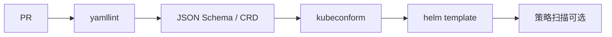

# 实践纪律与 Lint 清单

> 你改变不了生态默认解析器，但可以改变仓库里的习惯。

## 写作纪律

1. 可疑标量加引号：国家码、on/off、yes/no、版本号、时间、权限位、前导零。
2. 两空格缩进；禁止 Tab 做缩进。
3. 新文件后缀 `.yaml`；不为改后缀大规模 rename。
4. 少用 anchor；复用走模板/库 chart/生成器。
5. 多文档谨慎；确认工具走 `load_all` 还是只读首文档。
6. 应用代码禁止无 Loader 的 `yaml.load` / `unsafe_load` 读不可信输入。

## CI 清单

团队可写成 CONTRIBUTING 条款："布尔只允许 true/false；其它词必须引号。"对 K8s 1.35+ 客户端，文档示例可并行展示 `-o kyaml`。

## 最小可行规范（可直接贴进仓库）

- 所有国家码、开关词、版本号字段：双引号。
- CI：yamllint +（若有）kubeconform；Helm 项目必须 template 后再校验。
- 禁止应用路径使用 unsafe YAML loader。
- 新文件 `.yaml`；文档示例优先展示引号纪律。
- 变更解析库时，用 Norway/`on`/`1.10`/`0644` 四件套回归。

做到这五条，已经能消掉本调研里大多数高频事故面。

## 评审时看什么

Code review 与其对齐括号，不如盯：新增值是否可能被猜成布尔/数字；模板是否裸插外部字符串；CI 是否校验渲染结果；有没有新增 unsafe loader。YAML 的缺陷是语义层的，审查也要下沉到语义。

## 来源

- 交叉引用本仓库 `07`–`19`
- yamllint / kubeconform / actionlint 文档
