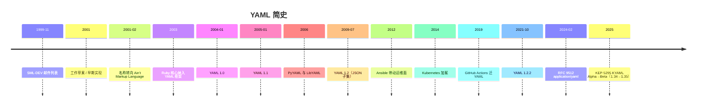

# YAML 大事记时间线

> 只列有据可查的节点；二手传闻不写死日期。

| 时间 | 事件 | 证据级别 |
| --- | --- | --- |
| 1999-11 | SML-DEV 启动 | 一手（sml-dev-archive） |
| 2001 | 早期草案仍名 Yet Another… | 一手（yaml.org/spec/history） |
| 2003 | Ruby 核心 YAML | 一手（1.2.2 History） |
| 2004-01-29 | 1.0 | 一手 |
| 2005-01-18 | 1.1 | 一手 |
| 2006 | PyYAML / LibYAML | 一手（History） |
| 2009-07-21 | 1.2 | 一手 |
| 2021-10-01 | 1.2.2 | 一手 |
| 2024-02 | RFC 9512 | 一手 |
| 2025-08 | K8s 1.34 KYAML Alpha | 一手（发布博客） |
| 2025 末 | 1.35 KYAML Beta 默认开 | 一手（sig-release 讨论 / 1.35 docs） |

## 来源

见各事件链接；总入口 `22-bibliography.md`。
