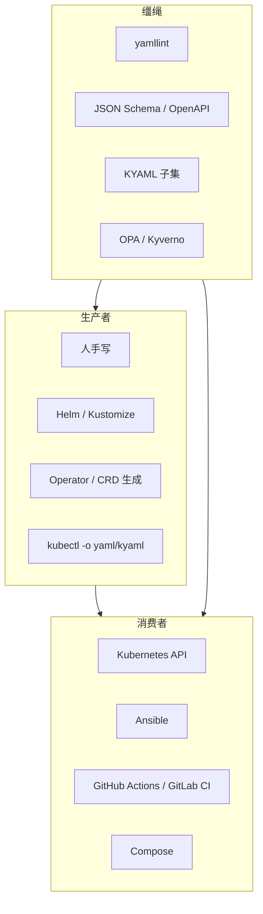

# 生态地图（简图）

> 谁在生产 YAML、谁在消费 YAML、谁在给它套缰绳。

## 阅读路径推荐

1. 故事与论点：根 README → `02` `05` `06`
2. 踩坑：`07` `08` `09` `19`
3. 实现细节：`10`–`14`
4. 安全与治理：`15` `16` `20`
5. 未来子集：`18`
6. 年表与书目：`21` `22`

## 来源

- 各产品官方文档交叉索引；详见 `22`
